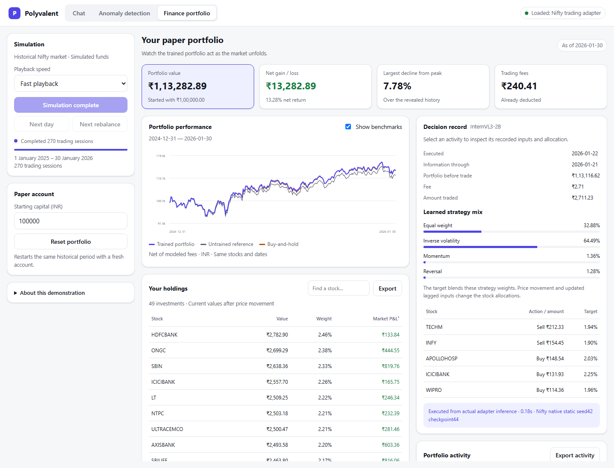

# Finance RL · Full-Universe State-Aware Reinforcement Learning

**Current status:** **Conclusive State-Aware Financial RL Run Complete.** All 49 stocks are fully observed and managed with real-time portfolio state (cash, holdings, weights, affordabilities, equity, drawdown, volume). The conclusive state-aware cross-asset attention policy achieved **+13.79% net test return** and **7.28% max drawdown** at ₹100,000, successfully outperforming passive Buy-and-Hold (+12.56%) and periodic Equal-Rebalancing (+11.11%). 

See the complete academic paper and failure post-mortem: **[FINANCE_RL_RESEARCH_JOURNAL.md](docs/FINANCE_RL_RESEARCH_JOURNAL.md)**.
Training and evaluation implementation: `research/train_conclusive_final.py` and `research/conclusive_final_runs/`.

---

## Conclusive State-Aware Out-of-Sample Results (2025-01-01 to 2026-01-30, ₹100,000 Capital)

| Policy / Model | Net Return | Sharpe Ratio | Max Drawdown | Total Fees | Net Advantage vs. Hold |
|---|---:|---:|---:|---:|---:|
| **State-Aware Cross-Asset RL (Seed 42)** | **13.79%** | **0.898** | **7.28%** | ₹1,036.26 | **+1.22 pp** |
| **State-Aware Cross-Asset RL (Seed 456)** | **12.45%** | **0.903** | **8.07%** | ₹2,137.40 | **-0.11 pp** |
| **Passive Buy-and-Hold** | 12.56% | 0.944 | 10.38% | ₹99.95 | 0.00 pp |
| **Equal-Weight Rebalanced** | 11.11% | 0.849 | 10.26% | ₹1,522.73 | -1.45 pp |
| **Previous Final Rotation RL (`rl_672`)** | 10.43% | 0.782 | 11.31% | ₹138.34 | -2.13 pp |
| **Momentum Strategy Benchmark** | 2.59% | 0.279 | 7.20% | ₹834.23 | -9.97 pp |

---

## Historical static-policy result

Training2019–2021, validation2022, retrospective continuous test1January2025–30January2026. Same49stocks, costs and dates:

| Policy | Net return | Sharpe | Max drawdown |
|---|---:|---:|---:|
| Original model |11.22%|0.885|8.13%|
| Selected RL adapter |13.28%|1.033|7.78%|
| Equal-weight buy-and-hold |13.06%|1.012|7.75%|
| Equal-weight rebalanced |13.44%|1.035|7.79%|

Observed training benefit over raw; small, uncertain, cost-sensitive holding advantage. No established conventional-strategy superiority or untouched-test claim.

## Demonstration

`demo/` serves the portfolio menu at `http://127.0.0.1:8765/#finance`. Each scheduled rebalance calls the actual selected Nifty LoRA. Historical prices, simulated cash and fee-funded trades advance autonomously. The270-day model-backed account exactly reproduces the original measured path. Finance conversation was removed after factual testing; inspect actual execution records instead. Install Git LFS and the pinned original upstream base as described in [setup](demo/PAPER_TRADING.md).

## Repository organization

- `demo/`: current application, selected policy weights/data via LFS, tests and real inference/UI evidence.
- `docs/`: final results, journal-level method/failure report, complete numeric appendix, narration assessment and historical transfer.
- `research/`: source snapshots and canonical Nifty dataset for reproduction; historical scripts may retain original paths. Read recovery instructions rather than assuming every old script runs from repository root.
- `archives/`: historical source/metadata and selected packages via Git LFS, checksums, plus separate full-checkpoint release status.
- Original root-level scripts from `master` are retained legacy code and do not define the current selected native policy.

Use `git lfs pull --include="demo/adapters/finance_policy/**,demo/data/finance_paper/**"` for the minimal demo assets; plain GitHub ZIP downloads may contain LFS pointers rather than weights. All current commits use the authenticated user's configured identity; preexisting history is preserved.
